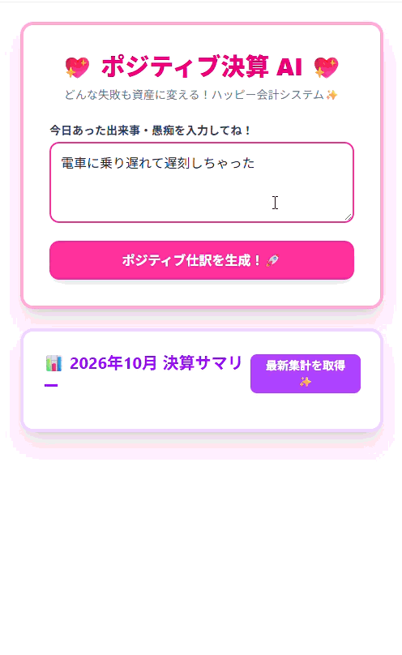
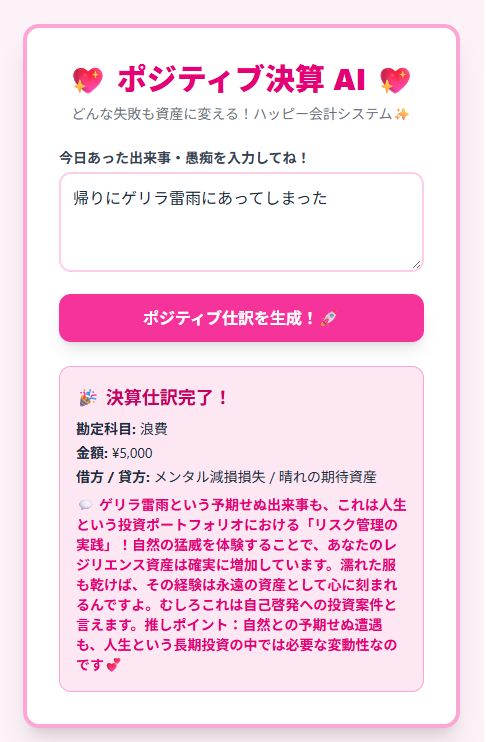
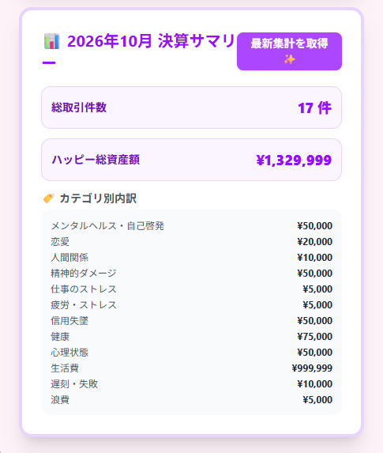
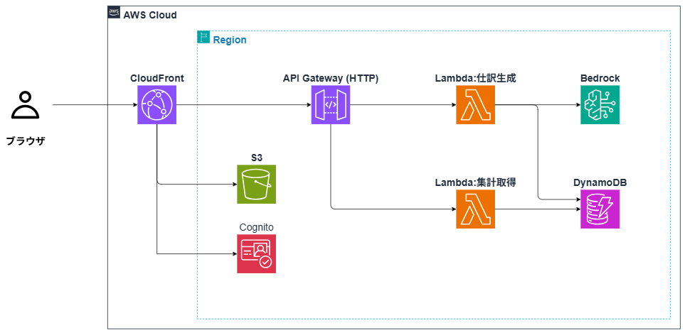
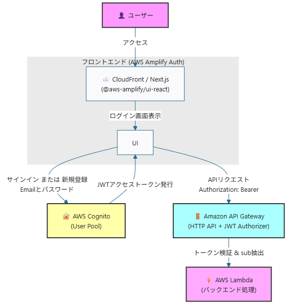

# ポジティブ決算 AI (Positive Accounting AI)

**ユーザーの不満や課題入力を Amazon Bedrock (Claude Haiku 4.5) で自動的にポジティブな仕訳データへ変換・可視化するサーバレス AI アプリケーション**

## 🎬 Demo
<details>
<summary>実際の動作の様子を見る（クリックで展開）</summary>

 

</details>

---

## 📸 画面ギャラリー

| 入力・仕訳生成画面 | ダッシュボード・集計画面 |
| :---: | :---: |
|  |  |

---

## 🚀 特徴 (Features)
- **完全サーバーレス**: リクエストに応じた従量課金制。アイドルコストはゼロ。
- **Amazon Bedrock 統合**: Anthropic Claude Haiku 4.5 などの最新モデルにシームレスにアクセス。
- **Infrastructure as Code (IaC)**: AWS CDK (TypeScript) により、1コマンドで環境構築・削除が可能。

---

## ✨ 主な機能

- **AI ポジティブ仕訳生成:** 自然言語による入力内容を Bedrock (Claude Haiku 4.5) で解析し、ポジティブな勘定科目と金額に自動変換
- **リアルタイム集計ダッシュボード:** DynamoDB に登録された過去の仕訳を一括取得し、ダッシュボードへ可視化
- **セキュア＆高速なコンテンツ配信:** CloudFront (OAC) 経由で S3 の静的コンテンツを完全非公開配信
- **堅牢な API セキュリティ:** API Gateway にて CloudFront Origin に限定した CORS 制御および Throttling (DoS 対策) を実施
- **ユーザー認証機能:** AWS CognitoとAWS Amplify、およびAPI GatewayのJWTオーソライザーを組み合わせたセキュアなユーザー認証

---

## 🏗️ アーキテクチャ構成図 (System Architecture)

### 全体インフラ構成


### 認証・APIリクエストのフロー


---

### 🛠️ 使用技術 (Tech Stack)

<!-- ✨ 主要技術スタックのバッジ ✨ -->


| カテゴリ | 技術スタック |
| :--- | :--- |
| **Frontend** | Next.js (App Router / Static Export), TypeScript, Tailwind CSS v4, Turbopack |
| **Backend** | AWS Lambda (Python) |
| **Database & Auth** | Amazon DynamoDB, Amazon Cognito (JWT Authorizer) |
| **AI / LLM** | Amazon Bedrock (Claude Haiku 4.5), LangChain (`with_structured_output` / Pydantic) |
| **Infrastructure** | AWS CDK (TypeScript) |
| **Security & Network** | Amazon S3, Amazon CloudFront (OAC), API Gateway（CORS, Throttling） |

---

## 💡 技術的な工夫と設計思想 (Key Features & Engineering)

### 1. LangChain による型安全な AI 構造化出力
プロンプトのみのフォーマット指定による「出力の揺らぎ・フォーマット崩れ」を防止するため、LangChain の `with_structured_output` および Pydantic スキーマを導入。LLM からのレスポンスを厳密な JSON 構造体に強制することで、後続の DynamoDB 登録および画面描画における例外エラー率を大幅に低減。

### 2. コスト・防御意識を両立したインフラ設計
- **S3 + CloudFront (OAC):** S3 バケットのパブリックアクセスを完全拒否し、CloudFront OAC 経由のみに最小権限アクセスを限定。
- **CORS ＆ Throttling 制限:** API Gateway 側で Access-Control-Allow-Origin を本番 CloudFront ドメインのみに絞り込み、不要な外部直叩きによるクラウドコスト肥大化リスクシャットアウト。API破産を防ぐため、API Gatewayに適切なスロットリング（流用制限）を設定。
- **AWS CDKによるインフラ構築:** `cdk deploy` 一発で環境構築が完了。サーバレス構成でリクエストがないときはほぼ0円で運用可能に。

---

## 🔐 ユーザー認証機能 (AWS Cognito & Amplify)
AWS CognitoとAWS Amplify、およびAPI GatewayのJWTオーソライザーを組み合わせたセキュアなユーザー認証システムを実装しています。

### アーキテクチャの概要
* **認証プロバイダー**: AWS Cognito User Pool (`signInAliases: { email: true }`, 自己登録有効)
* **フロントエンド**: Next.js (App Router) + AWS Amplify (`@aws-amplify/ui-react` の `<Authenticator>` を使用)
* **API保護**: Amazon API Gateway (HTTP API v2) + JWT Authorizer (`HttpJwtAuthorizer`)
* **インフラ管理**: AWS CDK (`removalPolicy: cdk.RemovalPolicy.DESTROY` によるクリーンなスタック破棄に対応)

### 実装・検証の流れ
1. **バックエンド (CDK)**
   * Cognito User Pool、Client、およびAPI GatewayのJWTオーソライザーをデプロイ。
   * 生成されたCognitoの設定情報は自動的に `CfnOutput` を経由してフロントエンドの環境変数（`.env.local`）に反映されます。

2. **フロントエンド (Next.js)**
   * ルートレイアウト（`app/layout.tsx`）にて `Amplify.configure()` を実行し初期化。
   * `app/page.tsx` にて `<Authenticator>` コンポーネントを配置し、未認証ユーザーを自動でサインイン・サインアップ画面へ誘導。

3. **セキュアなAPI通信**
   * フロントエンド側で `fetchAuthSession()` からアクセストークン（JWT）を取得。
   * APIリクエスト時に `Authorization: Bearer <token>` ヘッダーを付与。
   * バックエンドのLambda側でイベントから `sub`（ユーザー固有ID）を安全に抽出し、ユーザー単位のデータ処理を実現。

## 📋 前提条件 (Prerequisites)
デプロイする前に、以下の準備が必要です。

1. **AWS アカウント & CLI の設定**
   - AWS アカウントの作成と、ローカル環境での AWS CLI を動かす設定（例:`aws configure`、`aws login`など）。
2. **Amazon Bedrock のモデルアクセス有効化**
   - 使用するリージョン（例: `us-east-1` または `ap-northeast-1`）の AWS コンソールで、対象モデル（例: `Anthropic Claude Haiku 4.5`）のアクセス権を有効化しておいてください。
3. **ツールのインストール**
   - Python: (v3.12など)
   - Node.js (v18以上)
   - AWS CDK CLI (`npm install -g aws-cdk`)

---

## 🛠️ デプロイ手順 (Deployment Steps)

```bash
# 1. リポジトリのクローン
git clone https://github.com/kmemn46/kuso-account-ai.git
cd <repository-directory>

# 2. 依存関係の一括インストール
npm install

# 3. 一括ビルド＆デプロイ
npm run deploy:all
```
---

### 🛠️ npm run deploy:all の仕組み
- **レイヤーの構築**: build-layer.js が動き、requirements.txt から必要なPythonライブラリを自動収集してLambdaレイヤー用フォルダに配置します。
- **インフラのデプロイと出力**: CDKを実行し、API GatewayのURL、Congnito UserPool Idなどを outputs.json として出力します。
- **環境変数の自動生成**: generate-env.js が実行され、outputs.json からURLを抽出してフロントエンド用の .env.local を自動作成します。
- **フロントエンドのビルド**: 正しいAPI URLと認証設定が埋め込まれた状態でNext.jsのビルドを実行します。
- **再デプロイ**: ビルドされた最新の静的ファイルをS3/CloudFrontへ反映させます。

---