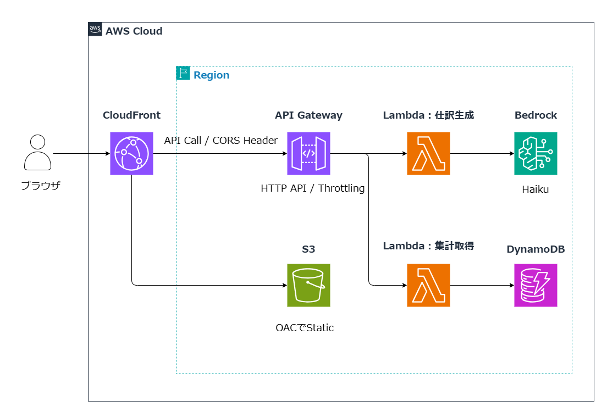
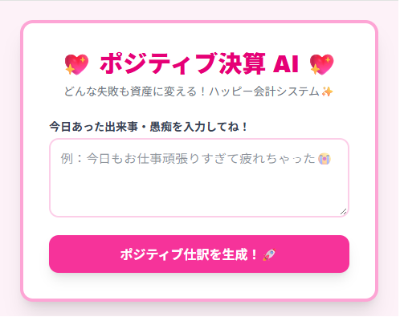
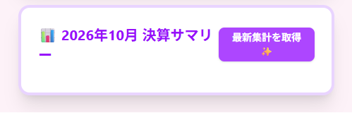

# 🚀 ポジティブ決算 AI (Positive Accounting AI)

**ユーザーの不満や課題入力を Amazon Bedrock (Claude 3 Haiku) で自動的にポジティブな仕訳データへ変換・可視化するフルスタック AI アプリケーション**

---

## 🎬 Demo

 <br>
*※仕訳入力から AI 構造化変換・DynamoDB への自動保存、リアルタイム集計表示の一連のフロー*

---

## ✨ 主な機能

- **🤖 AI ポジティブ仕訳生成:** 自然言語による入力内容を Bedrock (Claude 3 Haiku) で解析し、ポジティブな勘定科目と金額に自動変換
- **📊 リアルタイム集計ダッシュボード:** DynamoDB に登録された過去の仕訳を一括取得し、ダッシュボードへ可視化
- **🔒 セキュア＆高速なコンテンツ配信:** CloudFront (OAC) 経由で S3 の静的コンテンツを完全非公開配信
- **🛡️ 堅牢な API セキュリティ:** API Gateway にて CloudFront Origin に限定した CORS 制御および Throttling (DoS 対策) を実施

---

## 🏗️ アーキテクチャ構成図 (System Architecture)



<!-- ✨ 主要技術スタックのバッジ ✨ -->


### 🛠️ 使用技術 (Tech Stack)
| カテゴリ | 技術スタック |
| :--- | :--- |
| **Frontend** | Next.js (App Router / Static Export), TypeScript, Tailwind CSS v4, Turbopack |
| **Backend** | AWS API Gateway (HTTP API), AWS Lambda (Python) |
| **Database** | Amazon DynamoDB |
| **AI / LLM** | Amazon Bedrock (Claude Haiku 4.5), LangChain (`with_structured_output` / Pydantic) |
| **Infrastructure** | Amazon S3, Amazon CloudFront (OAC), IAM |

---

## 💡 技術的な工夫と設計思想 (Key Features & Engineering)

### 1. LangChain による型安全な AI 構造化出力
プロンプトのみのフォーマット指定による「出力の揺らぎ・フォーマット崩れ」を防止するため、LangChain の `with_structured_output` および Pydantic スキーマを導入。LLM からのレスポンスを厳密な JSON 構造体に強制することで、後続の DynamoDB 登録および画面描画における例外エラー率を大幅に低減させました。

### 2. 最小権限原則とコスト・防御意識を両立したインフラ設計
- **S3 + CloudFront (OAC):** S3 バケットのパブリックアクセスを完全拒否し、CloudFront OAC 経由のみに最小権限アクセスを限定。
- **CORS ＆ Throttling 制限:** API Gateway 側で Access-Control-Allow-Origin を本番 CloudFront ドメインのみに絞り込み、不要な外部直叩きによるクラウドコスト肥大化リスクをシャットアウト。

---

## 📸 画面ギャラリー

| 入力・仕訳生成画面 | ダッシュボード・集計画面 |
| :---: | :---: |
|  |  |
|  |  |

---

## 🚀 ローカル開発環境のセットアップ

```bash
# 1. リポジトリのクローン
git clone https://github.com/kmemn46/kuso-account-ai.git
cd kuso-account-ai/frontend

# 2. 依存パッケージのインストール
npm install

# 3. 開発サーバーの起動
npm run dev