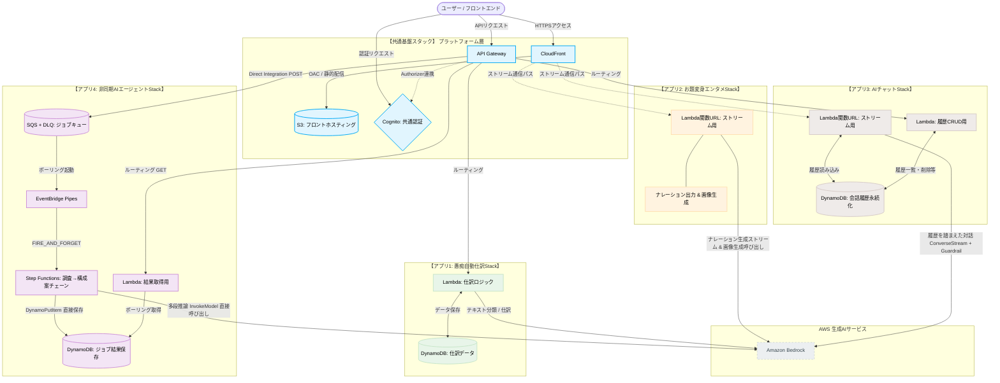
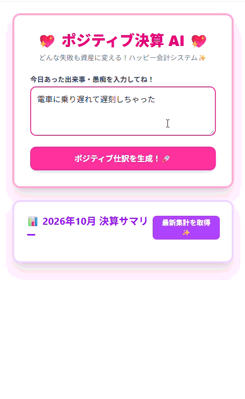
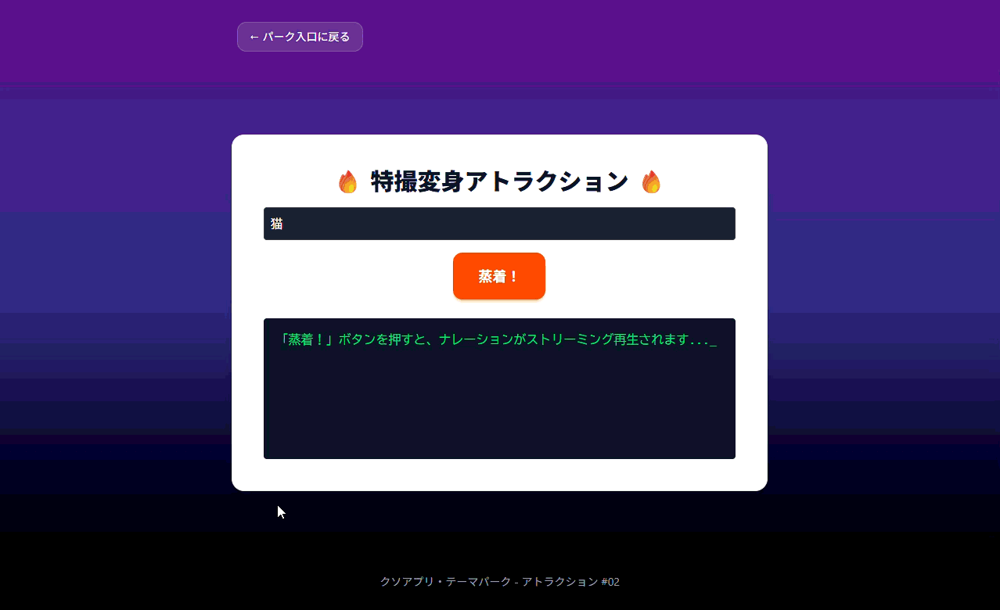
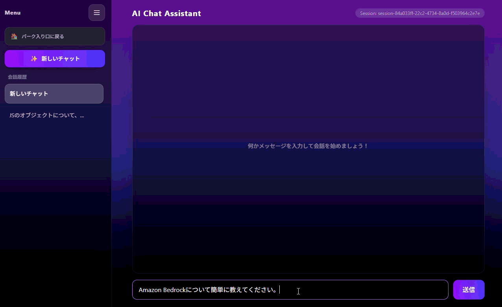
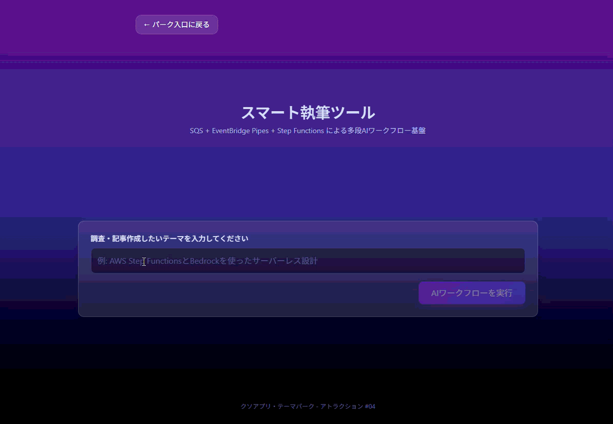

# 【AWS CDK】マルチアプリ対応・完全サーバーレスAIプロダクト基盤

現代のAIアプリケーションに必要なコンポーネント（Cognito認証、DynamoDB履歴永続化、Lambda関数URLによるストリーム配信、Amazon Bedrock連携）を共通化した、**コマンド一発で全自動デプロイ可能なAWS CDK（IaC）基盤**です。

本リポジトリは、この強固な共通インフラの上に、アーキテクチャの異なる4つの実用・エンタメAIアプリケーションを疎結合に同居させた、プロダクション品質のマルチテナント型ポートフォリオです。

---

## 🚀 本リポジトリの最大の価値（技術選定の理由）

1. **API Gatewayの制約を回避したLLMストリーム配信の実現**
   - API Gatewayのバッファリング制約を回避するため、CloudFront ＋ Lambda関数URL（Function URLs）を採用。ユーザー体験（UX）を損なわない、サクサク動く文字ストリーム配信（SSE）を実装。
2. **プラットフォーム共通化とアプリ独立のハイブリッド設計（疎結合スタック）**
   - フロント配信（S3+CloudFront）や認証（Cognito）などの基盤は共通スタックでコストと管理を最適化。
   - 各アプリのロジック（Lambda）やデータ（DynamoDB）は個別のStackに分離し、互いに影響を与えないマイクロサービス思想で設計。
3. **完全サーバーレスによる「運用コスト0円」運用**
   - アクティブユーザーがいない時間帯のインフラ維持費は完全に0円。企業の検証（PoC）フェーズに最適なコストパフォーマンスを実現。

---

## 📐 アーキテクチャ構成図



---

## 🛠️ 搭載アプリケーション（ユースケース）

本基盤の上で、現在以下の4つの独立したアプリケーションが同時に稼働しています。

### 1. 愚痴自動仕訳アプリ（API Gateway ➔ Lambda）
- **概要:** ユーザーの不満や課題入力をAIが自動でポジティブな勘定科目と金額に変換・可視化するアプリケーション。
- **技術的見どころ:** API Gatewayを介したセキュアなCRUD通信と、Amazon Bedrockによるテキスト分類プロンプトの最適化。
    <details>
    <summary>実際の動作の様子を見る（クリックで展開）</summary>

     

    </details>

### 2. お題変身エンタメアプリ（ストリーム配信 ➔ マルチモーダル生成）
- **概要:** ユーザーからのお題をもとに、AIがユニークな変身ナレーション（ストリーム）を出力しながら、同時に変身後の姿の画像を生成するエンタメアプリ。
- **技術的見どころ:** 1つのストリーム用Lambda関数URLから、ナレーション生成とAmazon Bedrockによる画像生成（マルチモーダル処理）をワンストップでオーケストレーション。
    <details>
    <summary>実際の動作の様子を見る（クリックで展開）</summary>

     

    </details>

### 3. 高機能AIチャット（Lambda関数URL ➔ ストリーム配信 ＋ DynamoDB）
- **概要:** 過去の文脈を記憶し、スムーズな対話ができる王道のAIチャット。
- **技術的見どころ:** 履歴のCRUD操作（削除や一覧取得）はCognito Authorizerを挟んだ安全なAPI Gateway経由で行い、メインのチャット対話のみをLambda関数URLによるストリームに流す「単一責任の原則」に基づいた実装。
    <details>
    <summary>実際の動作の様子を見る（クリックで展開）</summary>

     

    </details>

### 4. 非同期AIエージェント（API Gateway ➔ SQS ➔ EventBridge Pipes ➔ Step Functions ＋ DynamoDB）
- **概要:** AIリサーチャーとAIライターが、記事作成をフルサポート。
- **技術的見どころ:** 長時間処理やマルチステップの推論（調査 → 構成案作成など）に対応するため、同期チャット基盤とは別に完全サーバーレスの非同期ワークフローを構築。
    <details>
    <summary>実際の動作の様子を見る（クリックで展開）</summary>

     

    </details>

---

## 💎 主要な技術スタック & 運用のこだわり

### 💻 フロントエンド
- **Framework:** Next.js (App Router / TypeScript)
- **Hosting:** Amazon S3 + Amazon CloudFront (OACによるセキュアな静的配信)

### ⚙️ バックエンド / インフラ (AWS CDKによる完全コード化)
- **環境識別（Multi-Environment）:** `dev`（開発環境）と `prod`（本番環境）のコンテキスト切り替えに対応。完全に独立した環境への並行デプロイが可能。
- **API & Routing:** 
  - **AWS Lambda (Function URLs):** CloudFront直結によるCORS制約の回避、および最大15分間のLLMストリーム配信（SSE）の最適化。
  - **Amazon API Gateway:** Cognito Authorizerを挟んだセキュアなCRUD用API。バースト対策としてスロットリング（流量制限）を設定し、予期せぬ負荷やAPI破産を防止。
- **Authentication:** Amazon Cognito (User Pool / Client / API Gateway連携によるカスタム認可およびLambdaでのJWT検証)
- **Database:** Amazon DynamoDB (会話履歴の永続化、インデックス最適化)
- **CI/CD:** GitHub Actions（OIDC連携とIAM信頼ポリシー（subクレームによるリポジトリ・ブランチ制限）とcdk diff のPR自動コメントによる変更管理）
- **非同期 AI ワークフロー:**
  - **Functionless 設計によるコスト・レイテンシ最適化:** リクエスト受付（API Gateway → SQS）、キュー連携（EventBridge Pipes → Step Functions）、AI呼び出し、DB保存（`DynamoPutItem`）まで一切 Lambda を介さない直接統合を採用し、コールドスタートと不要なコンピュート課金を排除。
  - **耐障害性と流量制御:** SQS の可視性タイムアウトとデッドレターキュー（DLQ：`maxReceiveCount: 3`）によるメッセージ保護に加え、Step Functions 側で Bedrock のスロットリングエラーに対する指数バックオフリトライを実装。
  - **プロンプトチェーンによる精度向上:** 1回の推論に詰め込まず「調査（リサーチャー）」と「構成案作成（ライター）」にタスクを分割し、`resultSelector` / `resultPath` でコンテキストをバトンパスすることで出力品質を向上。


### 🤖 生成AI基盤 (Amazon Bedrock)
- **動的パラメータ管理（SSM Parameter Store）:**
  BedrockのモデルIDをインフラにハードコードせず、AWS Systems Manager Parameter Storeに集約。Lambda側でパラメータを**5分間キャッシュ**するロジックを組み込み、API呼び出しのオーバーヘッド削減とコスト最適化を両立。
- **セキュリティ・ガバナンス（Amazon Bedrock Guardrails）:** 
  アプリケーションコード側ではなくインフラ層（AWS CDK）で宣言的に入出力の安全性を担保しています。
  - **多層的なコンテンツ保護:** 有害表現のフィルタリングに加え、プロンプトインジェクション（Prompt Attack）の検知・ブロックを設定。
  - **機密情報（PII）の自動保護:** メールアドレスや電話番号の自動匿名化（マスキング）、クレジットカード番号やAWSアクセスキーの即時ブロックを実装。
- **Text / Stream:** Anthropic Claude Haiku 4.5
- **Image Generation:** Stability AI Stable Image Core v1.1 

---

## ⚡ クイックスタート（一発デプロイ手順）

本リポジトリは、以下のコマンドを実行するだけで、認証からフロント、バックエンド、AI連携まで全ての環境が自動構築されます。

```bash
# 依存関係のインストール
npm install

# AWS環境の初期化（初回のみ）
cdk bootstrap

# 全スタックの一括デプロイ
npm run deploy:all-dev (or cdk deploy:all-prod)

```

---

## 👨‍💻 開発者について

インフラ（AWS/CDK）の設計から、Lambdaバックエンドの実装、Amazon Bedrock等の生成AIを活用したプロダクトの開発まで、モダンなサーバーレスアーキテクチャの構築を得意としています。

「新規AIプロダクトを最速で立ち上げたい」「コスト効率の高いセキュアなAI基盤をAWS上に構築したい」といった企業様・発注者様からの業務委託・開発のご相談をお待ちしております。
